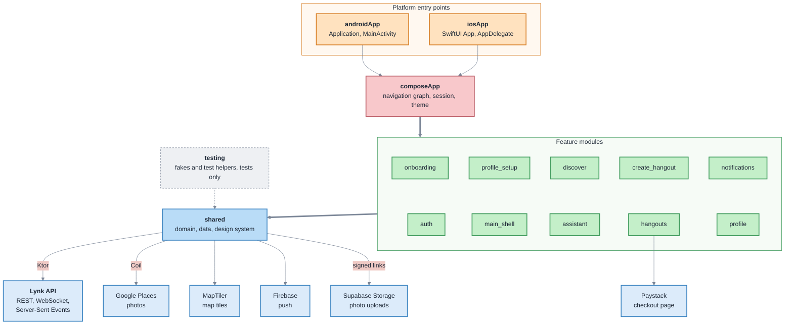

# Lynk

Stop arguing in the group chat. Just Lynk.

Friends create a hangout, invite their squad, vote on a spot everyone can reach, split the bill, and show up. This is
the app: one **Kotlin Multiplatform** codebase, with the UI written once in **Compose Multiplatform**, running natively on
Android and iOS against a live Spring Boot backend.

**Download:** [lynk.apk](https://github.com/EEseka/Lynk/releases/latest/download/lynk.apk) ·
**Website:** https://lynk.com.ng · **Backend:** [Lynk API](https://github.com/EEseka/lynk-api) ·
**Site source:** [Lynk Web](https://github.com/EEseka/lynk-web)

[](https://github.com/EEseka/Lynk/actions/workflows/android.yml)
[](https://github.com/EEseka/Lynk/actions/workflows/ios.yml)
[](https://github.com/EEseka/Lynk/actions/workflows/release.yml)
[](https://github.com/EEseka/Lynk/releases/latest)

---

<!-- Showcase images and demo clips go here. -->

## What it does

| Feature           | What it does                                                                                                                                     |
|-------------------|--------------------------------------------------------------------------------------------------------------------------------------------------|
| **Sign in**       | Google Sign-In or a guest account, then a profile with a live username availability check and an optional photo                                  |
| **Discover**      | A map of trending spots and a Top 10 near you, search, a price filter, opening hours, and saving the ones you like                               |
| **Lynk AI**       | Ask for ideas on Discover or in a hangout until it ends; answers stream in with spot cards you can open, save, suggest or plan a hangout at      |
| **Hangouts**      | Create one in three steps, invite friends by username, RSVP, edit, cancel, and browse by status with search and a vibe filter                    |
| **Host tools**    | Withdraw an invite, remove someone going and refund what they paid, take a spot off the ballot, and break a tie                                  |
| **Live lobby**    | Propose spots with a note on why, vote in real time, see who is in the room and who suggested what, and take back your own suggestion            |
| **On the day**    | From an hour before: notes for everyone going, with a choice of who is notified, and I'm Here to tell the rest you have arrived                  |
| **Hangout map**   | See the spots on the ballot or the chosen one, jump to where you are, and from an hour before, share your location with the group                |
| **Payments**      | The host turns on bill-splitting, everyone pays their share through Paystack inside the app, and the host gets paid out                          |
| **Albums**        | Everyone who went adds photos to one private album, with captions, saving and sharing                                                            |
| **Notifications** | Push notifications, an inbox with an unread badge, and invites you can accept or decline from a preview                                          |
| **Profile**       | Edit your profile, saved spots you can plan a hangout from, light, dark and Lights Out themes, haptics, push settings, and safe account deletion |

It adapts to the screen. Phones get a bottom bar and bottom sheets. Tablets and foldables show the hangout list
and detail side by side, open dialogs instead of sheets, and use a navigation rail on Android and the tab bar on iPad.

## Built with

<table>
  <tr>
    <td align="center" width="110"><br><b>Kotlin</b><br>2.4</td>
    <td align="center" width="110"><br><b>Compose Multiplatform</b><br>1.12</td>
    <td align="center" width="110"><br><b>Calf</b><br>Material 3 on Android, UIKit on iOS</td>
    <td align="center" width="110"><br><b>Ktor</b><br>REST, WebSocket, SSE</td>
    <td align="center" width="110"><br><b>Koin</b><br>dependency injection</td>
  </tr>
  <tr>
    <td align="center" width="110"><br><b>MapLibre</b><br>maps</td>
    <td align="center" width="110"><br><b>Coil</b><br>images</td>
    <td align="center" width="110"><br><b>KMPAuth</b><br>Google Sign-In</td>
    <td align="center" width="110"><br><b>Firebase</b><br>push</td>
    <td align="center" width="110"><br><b>GitHub Actions</b><br>CI, releases</td>
  </tr>
</table>

Also: Material 3 Adaptive · kotlinx.serialization · kotlinx.coroutines · kotlinx-datetime · Navigation Compose ·
DataStore · MapTiler tiles · Chrome Custom Tabs · moko-permissions · moko-geo · Kermit · Compottie ·
Multiplatform Markdown Renderer · ZoomImage · Lucide icons · BuildKonfig · Turbine · AssertK

## Architecture



A feature depends on another only to embed one of its screens: `main_shell` hosts the Discover, Hangouts and Profile
tabs; `discover`, `hangouts`, `profile` and `assistant` open the `create_hangout` sheet; `discover` and `hangouts` open
the Lynk AI chat; and `hangouts` shows the notifications inbox. Logic two features share always lives in `shared`.

Every screen follows the same **MVI** shape: an immutable `State`, `Action`s in, one-off `Event`s out, a `Root`
composable that wires the ViewModel and a `Screen` composable that only draws. Data flows through interfaces declared in
`shared/domain` and implemented in `shared/data`, so no ViewModel ever touches Ktor, DataStore or a platform API.

### Modules

```
androidApp       Android entry point: starts the app, opens a tapped notification, builds the installable APK
iosApp           iOS entry point: starts the app, hands returning links to Google Sign-In or to Lynk
composeApp       the app itself: navigation graph, session, theme and first-run state
shared           domain models and interfaces, Ktor services, the lobby WebSocket, DataStore,
                 design system, maps, deep links, date and money formatting,
                 platform code (location, media, permissions)
testing          one fake per shared interface plus test helpers; only ever a test dependency

feature/
  onboarding     first-run introduction
  auth           Google and guest sign-in
  profile_setup  username, display name and photo for a new account
  main_shell     tab navigation and the unread notification badge
  discover       map, trending spots, Top 10, search, saving a spot
  create_hangout the three-step sheet that creates and edits a hangout
  hangouts       hangout list, detail, live voting, notes, the live map, payments, albums
  notifications  inbox and invite previews
  profile        profile, settings, saved spots
  assistant      the Lynk AI chat, streamed answers and spot cards
```

### Things worth a closer look

**A lobby that manages its own connection.** The live lobby is a raw WebSocket with a small JSON envelope. It connects
only while the user is signed in, online and has the app open, disconnects as soon as any of those stops being true, and
retries with a backoff from 2 to 30 seconds. Everything from presence, votes and live locations to notes, payments, new
photos and host actions arrives over it.

**Payments the app cannot fake.** Paystack's checkout opens in the phone's own in-app browser, Safari View Controller on
iOS and a Chrome Custom Tab on Android, so card details go into the browser and never pass through Lynk. When the user
returns, the app does not mark anything as paid: it asks Lynk API, which checks with Paystack itself.

**One screen, six ViewModels.** Hangout detail is split by domain: `HangoutDetailViewModel` for the hangout itself,
`HangoutVotingViewModel` for the lobby, `HangoutPaymentsViewModel` for money, and `HangoutNotesViewModel`,
`HangoutLiveLocationViewModel` and `HangoutMemoriesViewModel` for notes, the live map and the album. The first three
share one in-memory `HangoutDetailRepository` in `shared`, so an update from any of them reaches the others without
passing data through the UI; the other three keep their own state and follow the lobby for live changes. Opening a
different hangout starts all six from a clean slate.

**Answers that type themselves out.** Lynk AI streams over Server-Sent Events. The text is revealed at a steady pace
measured in frame time, so it reads the same on a 60 Hz and a 120 Hz screen, renders as Markdown, and the spot cards
appear only once the words have finished. Every answer can be copied or shared, and the latest one asked again.

**Map markers are Compose, not map layers.** MapLibre draws the map; every marker is an ordinary composable placed on top
of it, so markers animate and theme like the rest of the app.

**Native where it matters.** On iOS the top bar, tab bar, buttons, switches, sliders, spinners, menus, dialogs and
action sheets are real UIKit controls, through Calf. Dates and times are picked in UIKit's own calendar and wheels,
in a popover UIKit presents above the app; Android uses Material's date and time dialogs. Haptics follow one token per
kind of interaction, and layouts avoid fixed heights so they grow with the system font size.

## Testing

Every test lives in `commonTest`, so the same test code runs on the **JVM** and on the **iOS simulator**.

```
hangouts          detail, lobby voting, notes, live locations, payments, albums, list, list-detail
shared            stores, paginator, unread counter, mappers, opening hours, date and money formatting, validators
create_hangout    the three-step flow and its validators
assistant         sending, streaming, failures, daily limits, chat history
profile           profile, settings, saved spots
notifications     inbox and invite previews
profile_setup     username checks, photo upload, submission
discover          trending, Top 10, search, filters, saving spots
composeApp        session, theme and first-run state
auth              Google and guest sign-in
main_shell        tabs and the unread badge
onboarding        first run
```

Every ViewModel is tested against every one of its actions, plus the logic that sits outside ViewModels: validators,
mappers, the lobby store, the paginator and the payment amount field. Every service in `shared` has one fake in the
`testing` module that all features reuse, and the in-memory stores run in tests as they are.

The suite tests behaviour, not pixels: screens only draw state that the ViewModel tests already cover, and the UI is
checked on real Android and iOS devices.

```bash
./gradlew testAndroidHostTest       # every test on the JVM
./gradlew iosSimulatorArm64Test     # every test on an iOS simulator (macOS only)
```

## CI and releases

| Workflow      | When it runs and what it does                                                                      |
|---------------|----------------------------------------------------------------------------------------------------|
| `android.yml` | every push and pull request: all tests on the JVM, then a debug APK kept for seven days            |
| `ios.yml`     | pull requests into `main` and on demand: all tests on an iOS simulator, then an unsigned app build |
| `release.yml` | a `v*` tag: tests, then a signed, R8-shrunk APK published to a GitHub Release as `lynk.apk`        |

The release APK is always named `lynk.apk`, because the website's Download button links to
`releases/latest/download/lynk.apk`.

## Running it

Needs **JDK 21** and **Android Studio**. The iOS app also needs **macOS** and **Xcode**.

```bash
git clone https://github.com/EEseka/Lynk.git && cd Lynk
./gradlew :androidApp:assembleDebug
```

For iOS, open `iosApp/iosApp.xcodeproj` in Xcode and run the `iosApp` scheme.

The app talks to the production API at `api.lynk.com.ng`, so it needs real keys to do anything useful.

### Configuration

Secrets go in `local.properties`, which git ignores. On CI the same names arrive as environment variables.

| Variables                                                                                | Used for                                  |
|------------------------------------------------------------------------------------------|-------------------------------------------|
| `API_KEY`                                                                                | the key Lynk API expects on every request |
| `WEB_CLIENT_ID`                                                                          | Google Sign-In                            |
| `MAP_TILER_API_KEY`                                                                      | map tiles                                 |
| `GOOGLE_PLACES_ANDROID_API_KEY` `GOOGLE_PLACES_IOS_API_KEY`                              | spot photos                               |
| `IS_DEBUG`                                                                               | optional; `true` logs every HTTP call     |
| `RELEASE_STORE_FILE` `RELEASE_STORE_PASSWORD` `RELEASE_KEY_ALIAS` `RELEASE_KEY_PASSWORD` | release builds only                       |

Firebase needs `androidApp/google-services.json`, also ignored by git.

## Installing the APK

1. On your Android phone, open [lynk.com.ng](https://lynk.com.ng) or the
   [latest release](https://github.com/EEseka/Lynk/releases/latest) and download `lynk.apk`.
2. Open it. Android asks once to allow installs from your browser; allow it.
3. Needs Android 7.0 or newer.

## Status

Android is released as a direct download. The iOS app builds and runs on a real iPhone; push notifications and the App
Store release wait on an Apple Developer account. Google Play comes next.

Payments are built and tested end to end against Paystack's test mode, but they do not take real money. Holding
attendees' money until the payment deadline counts as a regulated activity in Nigeria, and the licence it needs from
the Central Bank is out of reach for a solo developer.

## License

All rights reserved. The code is public to read, but not licensed for use. See [LICENSE](LICENSE).
